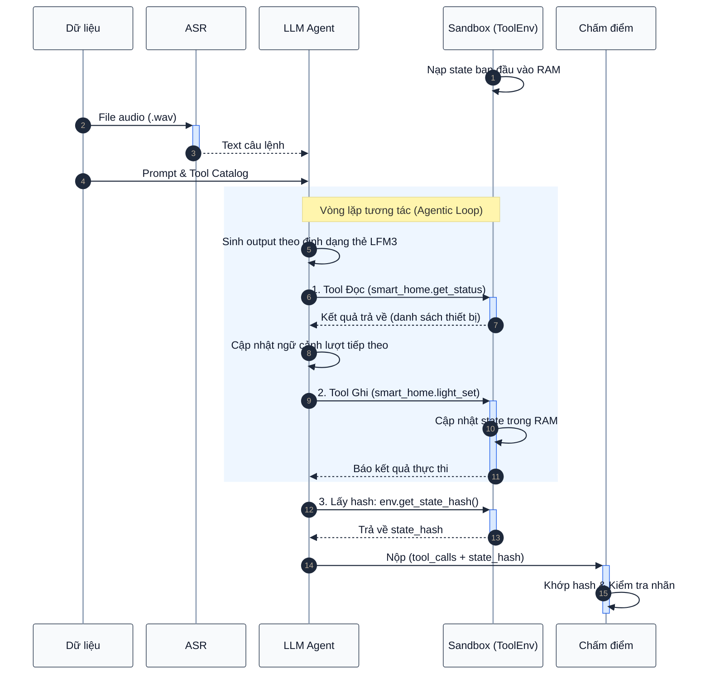

# Issue#3

### Sơ đồ

| Tệp tin | Chức năng chính |
| :--- | :--- |
| `sandbox.py` | Vòng lặp agent tương tác với `ToolEnv` và xuất kết quả `submission.jsonl`. |
| `metrics_offline.py` | Đo đạc 4 metrics (PSS, DDR, STLE, SVR) offline từ trace suy luận. |
| `modify_toolDescription.py` | Chuẩn hóa mô tả tool tự động từ metadata catalog (`kind`, `returns`, `x-ref`). |
| `System Prompt History.md` | Nhật ký theo dõi và đối chiếu số liệu thực nghiệm của System Prompt V1 & V2. |
| `convert_asr_fp16.py` | Tối ưu hóa mô hình ASR ONNX sang FP16 để tiết kiệm bộ nhớ GPU. |

---

## 1. Bản chất & Vai trò của 4 Metrics

### 1.1. Prefix Stability Score (PSS)

- **Bản chất:** Đánh giá mức độ ổn định của quyết định gọi tool khi hoán vị thứ tự khai báo tool trong system prompt, kiểm tra hiện tượng recency bias (ưu tiên gọi tool ở cuối danh sách). Ngoài ra, thứ tự tool cố định là tiền đề để tận dụng các cơ chế Prefix Caching (như trong vLLM) sau này nhằm giảm Time-to-First-Token khi triển khai thực tế.
- **Cách tính:** Giữ nguyên câu lệnh $x$, hoán vị thứ tự khai báo tools trong prompt ($\pi(\mathcal{T})$). Đo tỷ lệ mô hình giữ nguyên quyết định gọi tool:
  $$\text{PSS} = \frac{\#\text{lần giữ nguyên tool call đúng}}{\#\text{tổng số lần hoán vị}}$$
- **Vai trò:** Dùng ở giai đoạn offline để chọn cấu trúc prompt đạt $\text{PSS}$ tối đa.

### 1.2. Distractor Degradation Ratio (DDR)

- **Bản chất:** Đánh giá mức độ suy giảm độ chính xác khi đưa thêm các công cụ gây nhiễu vào context.
- **Cách tính:** So sánh độ chính xác khi chỉ cấp tools mục tiêu với khi cấp toàn bộ tools:
  $$\text{DDR} = 1 - \frac{\text{Accuracy}(\text{Target} \cup \text{Distractors})}{\text{Accuracy}(\text{Target Only})}$$
- **Vai trò:** Dùng ở giai đoạn offline để tinh gọn mô tả tool, tối ưu $\text{DDR} \to 0$.

### 1.3. Semantic Token Logit Entropy (STLE)

- **Bản chất:** Định lượng độ bất định giải mã ở chế độ `TEMPERATURE = 0`. Khi gặp câu lệnh mơ hồ hoặc thiếu thông tin, entropy của các token ngữ nghĩa sẽ tăng cao.
- **Cách tính:** Lấy logits ngay trong lượt sinh greedy, không cần sample thêm. Tính Shannon entropy trên các token tên hàm và tham số, bỏ qua các token định dạng thẻ của LFM3 (`<tool_call>`, `<function=...>`, `<parameter=...>`,...):
  $$\text{STLE} = -\frac{1}{|\mathcal{S}_{\text{semantic}}|} \sum_{i \in \mathcal{S}_{\text{semantic}}} \sum_{v \in \mathcal{V}} p_i(v) \log p_i(v)$$
- **Vai trò & Hiện trạng:**
  - Được đo offline qua `metrics_offline.py` để phân tích độ bất định của model.
  - Ý tưởng ứng dụng làm cổng chặn runtime (confidence gate): Kích hoạt `sys.ask_missing_info` khi $\text{STLE} > \tau$. Tuy nhiên, hiện tại chưa áp dụng làm cổng chặn vì thực nghiệm trên một số ít mẫu train cho thấy model bị tự tin thái quá, chưa thể xác định được ngưỡng $\tau$ tin cậy.

### 1.4. Schema Violation Rate (SVR)

- **Bản chất:** Đo tỷ lệ lệnh gọi tool vi phạm schema (thiếu trường required, sai kiểu dữ liệu, hoặc hallucinate trường mới):
  $$\text{SVR} = \frac{\#\text{tool calls vi phạm JSON schema}}{\#\text{tổng số tool calls được sinh ra}}$$
- **Vai trò & Hiện trạng:**
  - Đo ngoại tuyến trong `metrics_offline.py` để theo dõi mức độ tuân thủ schema qua các phiên bản prompt.
- **Chưa áp dụng cổng chặn tại runtime vì 2 lý do:**
  - **Model tuân thủ schema tốt ($SVR = 0.0$):** Thực nghiệm trên một vài mẫu train cho thấy các tool call đã parse được đều đúng kiểu dữ liệu và không bịa trường lạ.
  - **Cỡ mẫu còn nhỏ:** Chưa test đủ nhiều để thiết lập bộ chặn cho toàn bộ tools, chỉ cân nhắc kích hoạt nếu benchmark toàn tập train ghi nhận tỷ lệ lỗi schema tăng cao.

---

## 2. Bảng Phân định vai trò & Giai đoạn áp dụng

| Metric | Tên đầy đủ | Giai đoạn áp dụng | Mục tiêu kỹ thuật | Tác động đánh giá & Hiện trạng |
| :---: | :--- | :---: | :--- | :--- |
| **PSS** | Prefix Stability Score | Offline | Kiểm tra độ nhạy với thứ tự khai báo tool, hỗ trợ prefix caching. | Đo độ ổn định khi hoán vị schema, phát hiện recency bias. |
| **DDR** | Distractor Degradation Ratio | Offline | Đánh giá suy giảm độ chính xác khi thêm công cụ gây nhiễu. | Hướng tới việc tinh gọn mô tả tool (hiện chưa đo được do accuracy target = 0). |
| **STLE** | Semantic Token Logit Entropy | Offline | Đo độ bất định trên logits của token ngữ nghĩa. | Đánh giá mức độ tự tin, chưa dùng làm cổng chặn runtime do model overconfident. |
| **SVR** | Schema Violation Rate | Offline | Đo tỷ lệ gọi sai schema, thiếu trường hoặc sai kiểu dữ liệu. | Theo dõi lỗi cú pháp và tham số lạ sinh ra từ model. |

---

## 3. Sơ đồ luồng Sandbox thực tế



*Note:* Các metric phân tích như STLE (độ bất định giải mã) và SVR (tính hợp lệ schema) được trích xuất trong file đo lường riêng (`metrics_offline.py`), không can thiệp làm cổng chặn trong vòng lặp runtime của `sandbox.py`.

---

## 4. Chi tiết từng bước của luồng dữ liệu

### Bước 1: Khởi tạo
Môi trường `ToolEnv` nạp trạng thái từ file `state.json` của mẫu vào RAM. Agent không đọc trực tiếp file này mà chỉ thao tác qua các hàm của `ToolEnv`.

### Bước 2: Chuyển đổi giọng nói
File âm thanh (`.wav`) được đọc dưới dạng FP32 và chuyển qua mô hình ASR `gipformer1.5-68M-rnnt` để giải mã thành văn bản tiếng Việt. Các model ONNX của ASR được chuyển sang FP16 bên trong, đồng thời giữ các tensor I/O dấu phẩy động ở mức FP32.

### Bước 3: Nạp ngữ cảnh & Ghép Prompt
- Ghép văn bản câu lệnh cùng ngữ cảnh (`context`: vị trí, thời gian, hồ sơ) và lịch sử (`history`).
- Cung cấp danh mục công cụ (`tools`) được chuyển đổi qua `apply_chat_template`.

### Bước 4: Agentic Loop
Trong từng lượt suy luận (`TEMPERATURE = 0`):
1. **Sinh phản hồi:** Model sinh chuỗi phản hồi định dạng thẻ XML của LFM3 (`<tool_call><function=...><parameter=...>`).
2. **Phân tích cú pháp:** Parser trích xuất tên hàm và tham số. Nếu model không gọi thêm tool hoặc gọi `sys.ask_missing_info`, vòng lặp kết thúc.
3. **Thực thi trên Sandbox:** Các lệnh gọi được gửi đến `ToolEnv`. Công cụ tra cứu (read) trả dữ liệu về để đưa vào prompt lượt sau; công cụ hành động (write) cập nhật trạng thái trong RAM.
4. **Kiểm soát lặp:** Tùy chọn ngắt nếu model lặp lại cùng một tool call liên tiếp.

### Bước 5: Lấy mã băm & trích xuất Submission
Khi Agent kết thúc chuỗi hành động, môi trường gọi `env.get_state_hash()` để sinh `state_hash` và xuất bản ghi:
```json
{
  "id": "train_0004",
  "tool_calls": [
    {"name": "smart_home.get_status", "arguments": {}},
    {"name": "smart_home.light_set", "arguments": {"device_id": "light_bedroom2", "brightness": 50}}
  ],
  "state_hash": "fb27db99fbbb7964fb66a3e695ddb584304b2b2a2d1bfff13e027916e1719329"
}
```

### Bước 6: Chấm điểm
1. **Kiểm tra State Hash:** So khớp `state_hash` nộp với `gold state_hash`. Nếu không khớp, mẫu nhận điểm 0.
2. **Kiểm tra Tool-call:** So khớp chuỗi `tool_calls` đã thực thi với nhãn chuẩn trong `train.jsonl`.

---

## 5. Cải thiện model trước khi train

### 5.1. Cải thiện System Prompt

Từ kết quả chạy V1 Baseline, qua phân tích các trace log trên 5 mẫu train được chọn, System Prompt V2 được thiết kế gồm 4 quy tắc nhằm xử lý các lỗi quan sát được. Thử nghiệm dùng LFM3-1.7B FP16 với greedy decoding trên cùng kết quả phiên âm ASR của V1. System Prompt V2:

```text
Bạn là trợ lý điều khiển thiết bị và dịch vụ qua công cụ. Tuân thủ nghiêm ngặt các quy tắc sau:
1. Chỉ dùng thông tin từ context, history và kết quả trả về của các công cụ. Tuyệt đối không suy diễn dữ liệu ngoài các nguồn này.
2. Khi thiếu thông tin để thực hiện, ưu tiên dùng công cụ tra cứu liên quan. Chỉ gọi sys.ask_missing_info khi không có công cụ tra cứu hoặc tra cứu không xác định được.
3. Không gọi lại cùng một công cụ với cùng bộ tham số nếu công cụ đó đã trả về kết quả ở lượt trước.
4. Với yêu cầu ngoài phạm vi công cụ, phản hồi trực tiếp cho người dùng, không gọi tool.
```

#### Kết quả thực nghiệm V2 và điểm nghẽn còn lại

Khi cấp tất cả tool được phép của từng mẫu theo thứ tự gốc, thử nghiệm cho thấy:

- **Thay đổi quan sát được:** Ở mẫu `train_0008`, V2 tự kết thúc sau một lần gọi `alarm.list`. Với V1, model lặp lại call này và lượt chạy được dừng sau ba call giống nhau. V2 vẫn bỏ sót bước tra cứu thời tiết.
- **Các lỗi còn lại:**
  - Bỏ sót yêu cầu trong câu ghép (`train_0003`): Yêu cầu gồm 3 việc (tra hóa đơn điện, nạp điện thoại cho bác Ba, chuyển tiền cho cô Mai), nhưng model chỉ làm vế chuyển tiền và tự bịa số tiền `1.000.000` thay vì tra cứu hóa đơn (`845.000`).
  - Không xử lý mệnh đề điều kiện (`train_0008`): Yêu cầu "nếu mai mưa thì dời báo thức" cần gọi `weather.get_forecast` trước để kiểm tra thời tiết, nhưng model chỉ gọi `alarm.list`.
  - Tự sinh thông tin ngoài context (`train_0048`): Yêu cầu "gọi cho Lan", dù quy tắc 1 và 2 đã cấm suy diễn và hướng dẫn tra cứu hoặc hỏi lại, model vẫn tự bịa số điện thoại `09123456785` để gọi `phone.call`.
- **Đánh giá:** Số mẫu có toàn bộ tool call khớp chính xác theo thứ tự với nhãn vẫn là 1/5 ở cả V1 và V2. Bước chuyển từ V1 sang V2 được thực hiện thủ công qua việc đọc trace, chưa tích hợp GEPA.
- **Đề xuất:** Thử tích hợp GEPA để tự động đề xuất và chọn System Prompt dựa trên trace và kết quả đánh giá của agent. Sau đó so sánh prompt do GEPA đề xuất với V2 trên cùng bộ mẫu và cấu hình suy luận trước khi quyết định áp dụng.
- **Ghi chú:** Đây chỉ là thử nghiệm nhỏ, chưa đủ để kết luận giới hạn của System Prompt hoặc model.

---

### 5.2. Chuẩn hóa tool description từ metadata

#### Vấn đề của description gốc

`train_tools_catalog.json` là danh mục tool của tập train, chứa mô tả và schema tham số cho từng tool. Các mô tả dài ngắn không đều và chưa làm rõ mối quan hệ phụ thuộc giữa các công cụ (khi nào cần gọi công cụ tra cứu trước khi gọi công cụ hành động). Giả thuyết là điều này khiến model dễ chọn nhầm tool hoặc bỏ qua bước tra cứu khi có nhiều công cụ gây nhiễu.

Ví dụ ở mẫu `train_0003`, model tra cứu liên hệ rồi chuyển tiền ngay mà bỏ qua bước gọi `bill_payment.list_bills` để tra cứu số tiền, dẫn đến việc tự bịa số tiền và thất bại cả chuỗi hành động.

#### Metadata có sẵn trong catalog

Catalog train có 147 tool. Cả 147 tool đều có `kind` và `returns` (70 tool có giá trị, 77 tool để rỗng). Ngoài ra, `x-ref` có ở 65 tool và `x-match` ở 32 tool.

Trong file catalog, tool nằm tại `apps[].tools[]`: `kind` và `returns` là trường trực tiếp của tool. `x-ref` và `x-match` nằm trong schema `parameters` của tham số, ví dụ `parameters.properties.device_id.x-ref`.

- `kind`: `read`, `write`, `meta`.
- `returns`: tên dữ liệu trả về (`devices[]`, `alarms[]`, `bills[]`).
- `x-ref`: tham chiếu đến dữ liệu dùng cho tham số (ví dụ `device_id` trỏ tới `smart_home.devices`).
- `x-match: fuzzy`: trường văn bản tự do, chấm gần đúng.

Có thể dùng metadata để thử áp dụng cùng quy tắc cho tool mới, nếu catalog có đủ thông tin tương ứng. Hiệu quả của phương pháp này chưa được kiểm chứng.

#### Quy tắc chuẩn hóa

1. Gắn nhãn theo `kind`: `[TRA CỨU (Không đổi trạng thái)]` cho `read`, `[HÀNH ĐỘNG (Thay đổi trạng thái)]` cho `write`, `[HỆ THỐNG]` cho `meta`.
2. Sinh điều kiện gọi:
   - Tool `write` có tham số `required` mang `x-ref`: gợi ý tra cứu id nếu chưa có thông tin cần thiết.
   - Tool `read` có `returns`: bổ sung thông tin về dữ liệu trả về.
3. Ghép nhãn, mô tả gốc và điều kiện gọi thành một dòng mô tả.

#### Ví dụ trước và sau chuẩn hóa

| Tool | Mô tả gốc | Mô tả sau chuẩn hóa |
| :--- | :--- | :--- |
| `smart_home.get_status`<br>(kind: read) | "Lấy thiết bị và trạng thái; lọc theo phòng/tầng/loại..." | `[TRA CỨU (Không đổi trạng thái)] Lấy thiết bị và trạng thái... Trả về: devices[].` |
| `smart_home.light_set`<br>(kind: write) | "Bật/tắt/chỉnh sáng đèn" | `[HÀNH ĐỘNG (Thay đổi trạng thái)] Bật/tắt/chỉnh sáng đèn. Nếu chưa biết device_id, tra cứu thông tin cần thiết trước khi gọi.` |
| `sys.ask_missing_info`<br>(kind: meta) | "Báo các tham số bắt buộc còn thiếu của một tool" | `[HỆ THỐNG] Báo các tham số bắt buộc còn thiếu của một tool` |

---

## 6. Kế hoạch huấn luyện

### 6.1. Hướng đề xuất

Ưu tiên Full-parameter SFT để dạy model thực hiện chuỗi tool call qua nhiều lượt. Dùng dữ liệu tổng hợp gồm yêu cầu, context, tool schema, tool call đúng và kết quả tool, tập trung vào các lỗi đã quan sát:

- Bỏ sót yêu cầu.
- Bỏ qua điều kiện.
- Thiếu thông tin và tự sinh giá trị.

Có thể dùng `SFTTrainer` của Hugging Face TRL và tham khảo notebook LFM3 của Liquid AI.

### 6.2. Đánh giá và phát triển tiếp

1. So sánh model sau SFT với baseline trên cùng dữ liệu, prompt, tool schema và ASR. Đánh giá kết quả cuối và tool call theo metric cuộc thi, đồng thời xem riêng các nhóm lỗi ở trên.
2. Nếu SFT còn lỗi phù hợp và có cặp hành vi đúng/sai đáng tin cậy, thử DPO trên dữ liệu tổng hợp để ưu tiên hành vi đúng, sau đó so sánh với SFT.
3. Cân nhắc GRPO sau khi có môi trường tương tác và reward kiểm chứng được. GRPO thường cần các rollout khác nhau cho cùng yêu cầu. Cần làm rõ quy định `temperature = 0` có áp dụng trong lúc tạo rollout huấn luyện hay không trước khi thử.
4. Chỉ cân nhắc CPT nếu có bằng chứng model vẫn không hiểu từ lóng hoặc cách diễn đạt trong miền sau khi thử prompt và SFT.

Tất cả các bước cập nhật trọng số đều dùng full-parameter training, không dùng LoRA, QLoRA hay DoRA.

### 6.3. Tóm tắt các kỹ thuật

| Kỹ thuật | Dữ liệu đầu vào | Cơ chế học | Tác dụng chính |
| :---: | :--- | :--- | :--- |
| **CPT** | Văn bản thô (`raw text`). | Dự đoán token tiếp theo trên toàn bộ văn bản. | Bổ sung tri thức miền hoặc mở rộng vốn từ ngữ mới. |
| **SFT** | Cặp `(Prompt, Đáp án mẫu)`. | Tối ưu loss trên các token của đáp án mẫu để học hành vi chuẩn. | Học định dạng thẻ gọi tool, tuân thủ quy tắc và chuỗi hành động mẫu. |
| **DPO** | Bộ ba `(Prompt, Đáp án tốt, Đáp án tệ)`. | Tăng xác suất của phản hồi tốt và giảm xác suất của phản hồi sai. | Hướng tới khắc phục các lỗi sai cụ thể (như tự sinh giá trị thay vì hỏi lại). |
| **GRPO** | `Prompt` kèm hàm chấm điểm (`Reward/Verifier`). | Sinh $G$ rollout cho mỗi prompt, tự chấm điểm và tối ưu theo ưu thế nhóm. | Hướng tới tối ưu trực tiếp theo metric mục tiêu và tăng cường khả năng suy luận. |

