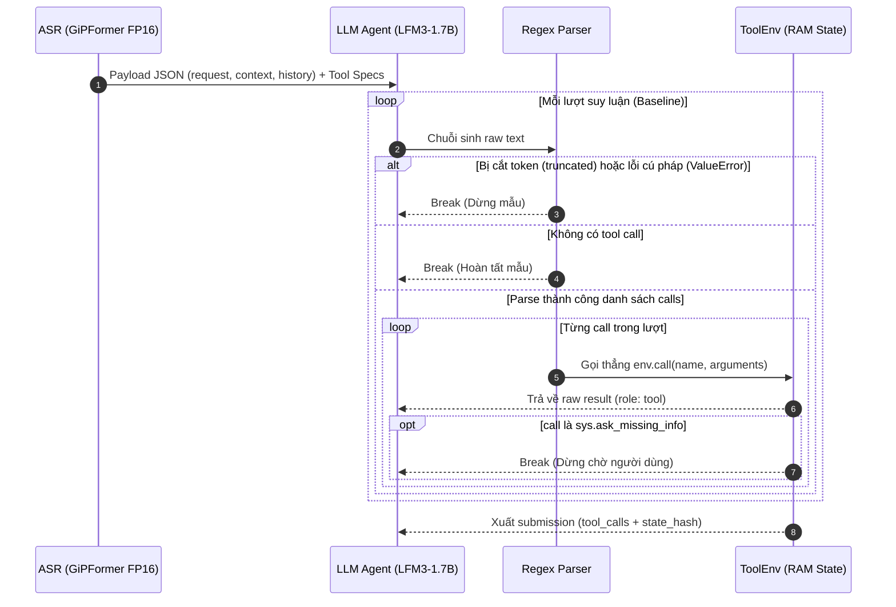
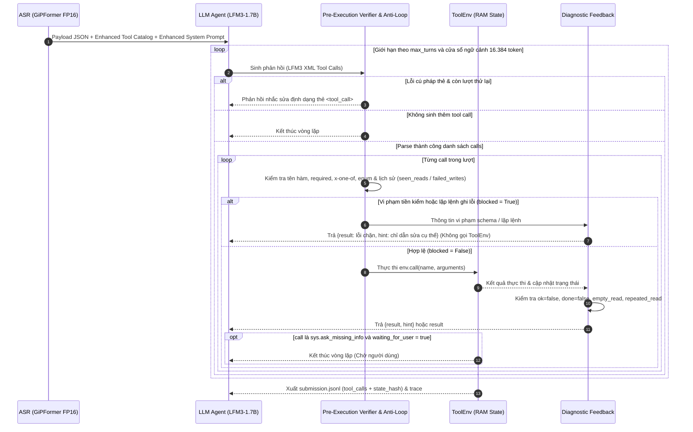

# Sandbox History

## Literature Review: SWE-agent

- **Title:** SWE-agent: Agent-Computer Interfaces Enable Automated Software Engineering.
- **Authors / Org:** John Yang, Carlos E. Jimenez, Alexander Wettig, Kilian Lieret, Shunyu Yao, Karthik Narasimhan, Ofir Press — Princeton University.
- **Date & Freshness:** NeurIPS 2024, repo cập nhật giai đoạn 2025–2026.
- **Venue / Source:** NeurIPS 2024, CORE A*, [arXiv:2405.15793](https://arxiv.org/abs/2405.15793) · [SWE-agent/SWE-agent](https://github.com/SWE-agent/SWE-agent) (~16k stars).

### Phương pháp

Paper thiết kế Giao diện Tác tử - Máy tính (Agent-Computer Interface - ACI) làm lớp trung gian giữa mô hình ngôn ngữ và môi trường thực thi:
1. Kiểm tra tính hợp lệ của lệnh gọi (syntax/linter guardrails) trước khi áp dụng thay đổi lên môi trường.
2. Định dạng lại kết quả trả về và thông báo lỗi theo cấu trúc ngắn gọn để giữ gọn ngữ cảnh qua nhiều lượt.
3. Chặn các thao tác lỗi lặp lại để buộc mô hình đổi hướng xử lý.

### Kết quả và giới hạn

- Đạt 12,5% pass@1 trên SWE-bench đầy đủ, tăng 8,7 điểm phần trăm so với baseline RAG tại thời điểm công bố.
- Thí nghiệm cắt giảm thành phần cho thấy khi bỏ lớp kiểm tra trước thực thi và phản hồi lỗi có cấu trúc, mô hình lặp lại các lệnh sai cú pháp làm hỏng trạng thái môi trường.

### Áp dụng cho LifeMate

Đặt bước kiểm tra trước khi gọi `ToolEnv` để chặn các lệnh ghi lặp lại ngay sau khi thất bại hoặc sai cấu trúc, tránh làm thay đổi trạng thái ngoài ý muốn trong RAM.

## Literature Review: ReIn

- **Title:** ReIn: Conversational Error Recovery with Reasoning Inception.
- **Authors / Org:** Takyoung Kim, Jinseok Nam, Chandrayee Basu, Xing Fan, Chengyuan Ma, Heng Ji, Gokhan Tur, Dilek Hakkani-Tür — University of Illinois Urbana-Champaign & Amazon.
- **Date & Freshness:** ICLR 2026, công bố tháng 02/2026.
- **Venue / Source:** ICLR 2026, CORE A*, [arXiv:2602.17022](https://arxiv.org/abs/2602.17022).

### Phương pháp

ReIn phục hồi lỗi trong hội thoại gọi công cụ bằng cách can thiệp ở thời điểm suy luận (test-time intervention) mà không sửa trọng số mô hình:
1. Theo dõi kết quả trả về từ công cụ để phát hiện lỗi thực thi, kết quả rỗng hoặc yêu cầu thiếu thông tin.
2. Đính kèm một gợi ý điều hướng ngắn (Inception Block) ngay sau kết quả công cụ để dẫn dắt lượt suy luận kế tiếp.

### Kết quả và giới hạn

- Cải thiện tỷ lệ phục hồi lỗi qua nhiều lượt trên các benchmark hội thoại trạng thái (ToolSandbox, τ-bench) với các mô hình kích thước nhỏ dưới 8B tham số.
- Nếu gợi ý quá dài hoặc ép gọi một công cụ cố định khi chưa đủ dữ kiện, mô hình nhỏ dễ làm theo máy móc.

### Áp dụng cho LifeMate

Ghép cặp `{result, hint}` vào phản hồi của Sandbox khi công cụ trả về `ok = false`, `done = false`, hoặc khi công cụ đọc trả về danh sách rỗng do bộ lọc tùy chọn.

## Literature Review: Beyond Accuracy (PTE)

- **Title:** Beyond Accuracy: Unveiling Inefficiency Patterns in Tool-Integrated Reasoning.
- **Authors / Org:** Qisheng Su, Juntao Li, Qiaozhi He, Penghui Qi, Min Zhang — Soochow University & USTC.
- **Date & Freshness:** ACL 2026 Long Paper, công bố năm 2026.
- **Venue / Source:** ACL 2026 Main Conference, CORE A*, CCF-A · [sqs-ustc/tool-reasoning-framework-PTE](https://github.com/sqs-ustc/tool-reasoning-framework-PTE).

### Phương pháp

Paper đo lường chi phí thực thi qua nhiều lượt bằng Prefill Token Equivalents (PTE) và xác định các mẫu hành vi gây suy giảm hiệu năng:
1. Gọi công cụ xác nhận dư thừa (Confirmatory Tool Usage): Gọi lại công cụ đọc với cùng tham số khi đã có kết quả từ lượt trước.
2. Trộn lẫn công cụ không liên quan (Tool-Mixing) và thiếu tri thức về công cụ (Lack of Tool Priors).
3. Sụp đổ định dạng thẻ gọi công cụ (Tool Format Collapse): Khi chuỗi sinh kéo dài, mô hình sinh sai quy ước thẻ đóng/mở hàm làm hỏng cú pháp của lượt đó.

### Kết quả và giới hạn

- Quỹ đạo suy luận kéo dài và gọi công cụ lặp lại làm tăng chi phí ngữ cảnh cộng dồn và tương quan nghịch với độ chính xác cuối cùng.
- Ngăn các lệnh đọc lặp lại và xử lý lỗi sụp đổ định dạng thẻ giúp giữ gọn lịch sử hội thoại qua nhiều lượt.

### Áp dụng cho LifeMate

Giải thích hiện tượng lỗi parser (`Thinking chưa đóng`, `Tool call không đúng định dạng LFM3`) và hành vi gọi lặp lệnh đọc (`repeated_read`), làm cơ sở để phục hồi lỗi cú pháp thẻ và theo dõi các lệnh đọc đã chạy trong mẫu.

## Literature Review: TokenCliff

- **Title:** TokenCliff: Benchmarking Output-Token Budget Sensitivity in Multi-Turn LLM Agents.
- **Authors / Org:** Zixi Zhang et al.
- **Date & Freshness:** EMNLP 2026 Main Conference, công bố năm 2026.
- **Venue / Source:** EMNLP 2026 Main Conference, CORE A.

### Phương pháp

TokenCliff đánh giá độ nhạy của tác tử nhiều lượt khi áp ngân sách token đầu ra trên từng lượt và phân loại 5 trạng thái dừng thất bại: chạm trần token (`BudgLim`), chạm trần số lượt (`TurnLim`), gọi sai hành động (`WrongA`), kết thúc sớm khi chưa hoàn tất yêu cầu (`EarlySub`), và lỗi cú pháp/hệ thống (`Other`).

### Kết quả và giới hạn

- Đặt trần token mỗi lượt thấp hơn ngưỡng tối thiểu (Cliff Index) làm chuỗi suy luận bị cắt cụt trước khi mô hình kịp phát sinh lời gọi công cụ, dẫn đến sụt giảm điểm đột ngột.

### Áp dụng cho LifeMate

Làm cơ sở thực nghiệm để bỏ hoàn toàn trần token mỗi lượt (`max_tokens = None`). Do `LFM3-1.7B` sinh khối `<think>` dài trước khi mở thẻ `<tool_call>` (40,78% mẫu vượt 512 token và 14,17% mẫu vượt 1.536 token mỗi lượt ở Baseline), mô hình được phép sinh tự do trong phần ngữ cảnh còn lại của cửa sổ 16.384 token (tối đa 20 lượt) để không bị cắt cụt giữa chừng.

---

## Baseline

Trong `sandbox_baseline.py` (chế độ mặc định `self_heal = False`), vòng lặp tương tác hoạt động như sau:

1. Khởi tạo và nạp ngữ cảnh:
   - Tạo `ToolEnv("train", sample["id"])` nạp trạng thái ban đầu từ `state.json` vào RAM.
   - Phiên âm file âm thanh qua ASR `gipformer1.5-68M-rnnt` (hoặc lấy `audio_text`), đóng gói `request`, `context` và `history` thành chuỗi JSON trong message của `user`.
   - Lấy danh sách công cụ thuộc `installed_apps` cùng `sys.ask_missing_info` và đưa qua `apply_chat_template` (`enable_thinking=False`).
2. Sinh phản hồi và phân tích cú pháp (`parse_tool_calls`):
   - Giải mã greedy (`do_sample=False`, `float16`) trong cửa sổ ngữ cảnh `CONTEXT_TOKENS = 16384`.
   - Dùng regex tách các khối `<tool_call><function=...><parameter=...>...</parameter></function></tool_call>`.
   - Nếu output bị cắt do chạm giới hạn token (`truncated = True`) hoặc gặp lỗi cú pháp (`ValueError`: thẻ `<think>` chưa đóng, sai cấu trúc thẻ `<tool_call>`, trùng khóa tham số, hoặc lỗi `json.loads` khi ép kiểu phi chuỗi), vòng lặp dừng ngay (`break`) và kết thúc mẫu.
3. Thực thi công cụ và xuất kết quả:
   - Mọi lệnh gọi tách được đều truyền thẳng vào `env.call(name, arguments)`.
   - Kết quả `result` từ `ToolEnv` được đưa nguyên bản vào message `role = "tool"` của lượt tiếp theo.
   - Vòng lặp kết thúc khi mô hình không gọi thêm tool, khi gọi `sys.ask_missing_info`, hoặc khi đạt giới hạn lượt. Cuối cùng lấy `env.get_tool_calls()` và `env.get_state_hash()` để ghi ra `submission.jsonl`.

---

## Manual Finding

Đối chiếu `sandbox_baseline.py` (bao gồm cả nhánh `--self-heal` hiện có) với các bài báo trên cho thấy 5 điểm hạn chế:

| Hạn chế trong Sandbox hiện tại | Nguyên nhân kỹ thuật | Tác động thực tế |
| --- | --- | --- |
| 1. Dừng mẫu ngay khi lỗi cú pháp thẻ | Khi `parse_tool_calls` gặp `ValueError` ở một lượt, vòng lặp `break` ngay thay vì báo lỗi định dạng để mô hình sinh lại. | Mất toàn bộ kết quả của mẫu nếu mô hình sinh trượt một thẻ đóng/mở hoặc sai định dạng JSON của tham số. |
| 2. Truyền thẳng lệnh vi phạm schema vào `ToolEnv` | Chưa kiểm tra tên hàm, tham số `required`, nhóm `x-one-of`, khóa lạ hay giá trị `enum` trước khi gọi `env.call()`. | Các lệnh sai cấu trúc vẫn bị ghi vào danh sách `tool_calls` nộp đi và có thể làm thay đổi trạng thái trong RAM ngoài ý muốn. |
| 3. Gợi ý sửa lỗi (`healing_feedback`) còn chung chung | Khi `ok = false`, nhánh `--self-heal` hiện chỉ trả câu cố định `"Sửa tham số theo lỗi và schema..."` mà không nêu tên tham số sai hay công cụ tra cứu nguồn. | Mô hình 1.7B khó tự xác định trường cần sửa nếu chỉ nhận thông báo chung. |
| 4. Chỉ kiểm tra lặp với đúng 1 lệnh liền kề (`previous_execution`) | Biến `repeated` chỉ so sánh lệnh hiện tại với lệnh ngay trước đó. Nếu mô hình gọi xen kẽ `A -> B -> A`, Sandbox không phát hiện được lệnh `A` bị lặp. | Dẫn đến việc gọi lại các lệnh đọc đã có kết quả hoặc thử lại lệnh ghi đã thất bại ở các lượt cách nhau. |
| 5. Chưa kiểm tra lỗi truyền từ tiếng Việt vào trường `enum` | Mô hình đôi khi lấy nguyên từ tiếng Việt trong câu lệnh để điền vào tham số có danh sách `enum` cố định. | Gây lỗi thực thi dù mô hình đã chọn đúng công cụ. |

---

## Thiết kế Enhanced Sandbox Harness

Thiết kế Enhanced Sandbox mở rộng nhánh `--self-heal` hiện tại thành 4 bước kiểm soát dựa trên metadata của catalog:

### 1. Cấu trúc 4 thành phần xử lý tại Runtime

| Thành phần | Cơ sở tham chiếu | Cơ chế hoạt động |
| --- | --- | --- |
| 1. Phục hồi lỗi cú pháp thẻ gọi công cụ | Beyond Accuracy | Khi `parse_tool_calls` gặp `ValueError` (sai cấu trúc thẻ `<tool_call>`, trùng tham số hoặc lỗi `json.loads`) mà lượt sinh chưa chạm trần ngữ cảnh 16.384 token và vẫn còn lượt trong `max_turns`, không `break` ngay mà trả thông báo lỗi cú pháp để mô hình sinh lại ở lượt kế tiếp (tối đa 1 lần thử lại liên tiếp cho lỗi cú pháp). |
| 2. Tiền kiểm Schema & `enum` trước thực thi (Pre-Execution Verifier) | SWE-agent | Trước khi gọi `env.call()`, đối chiếu lệnh gọi với `specs` của catalog: kiểm tra tên hàm có trong tập được phép, kiểm tra đủ trường `required`, đúng quy tắc `x-one-of`, không chứa khóa lạ ngoài `properties`, đúng `type` và thuộc danh sách `enum` (nếu có). Nếu vi phạm, đặt `blocked = True`, không gọi `env.call()` và trả thông báo chỉ rõ trường vi phạm. |
| 3. Chống lặp trên toàn bộ quỹ đạo mẫu | Beyond Accuracy, SWE-agent | Lưu tập các lệnh đọc đã chạy thành công (`seen_reads`) và các lệnh ghi đã thất bại (`failed_writes`) trong suốt mẫu. Nếu trạng thái môi trường chưa thay đổi, chặn các lệnh ghi nằm trong `failed_writes` (kể cả khi gọi xen kẽ qua lượt khác) và nhắc dùng dữ liệu cũ đối với lệnh đọc nằm trong `seen_reads`. |
| 4. Gợi ý sửa lỗi chỉ đích danh theo Metadata | ReIn | Khi lệnh bị từ chối hoặc trả về rỗng, tạo `hint` cụ thể từ schema: nêu tên tham số thiếu/lỗi, liệt kê danh sách `enum` hợp lệ, chỉ ra công cụ `[TRA CỨU]` nguồn từ trường `x-ref` khi chưa biết ID, hoặc liệt kê tên các tham số lọc tùy chọn cần cân nhắc bỏ bớt khi kết quả đọc trả về `[]`. |

### 2. Bảng quy tắc tín hiệu và phản hồi

| Tình huống | Tín hiệu tại Sandbox | Xử lý của Harness | Nội dung `hint` phản hồi cho lượt kế tiếp |
| --- | --- | --- | --- |
| Lỗi cú pháp thẻ LFM3 | `parse_tool_calls` tung `ValueError` | Không gọi `ToolEnv`, cho phép sinh lại nếu còn lượt | `Lỗi định dạng thẻ gọi công cụ (<error>). Sinh lại đúng cấu trúc <tool_call><function=tên_hàm><parameter=tên_tham_số>giá_trị</parameter></function></tool_call>.` |
| Sai tên công cụ | `call["name"] not in specs` | Chặn trước khi gọi `ToolEnv` (`blocked = True`) | `Công cụ <name> không có trong danh sách được cấp. Chỉ chọn công cụ thuộc danh sách hiện có.` |
| Sai khóa tham số | Thiếu trường `required`, sai `x-one-of`, hoặc dư khóa lạ | Chặn trước khi gọi `ToolEnv` (`blocked = True`) | `Sai cấu trúc tham số của <name>: thiếu [<missing>], khóa không hợp lệ [<unknown>]. Nếu chưa biết giá trị tham chiếu, gọi công cụ tra cứu liên quan trước hoặc dùng sys.ask_missing_info.` |
| Sai kiểu hoặc lệch `enum` | Giá trị không khớp `type` hoặc ngoài tập `enum` | Chặn trước khi gọi `ToolEnv` (`blocked = True`) | `Tham số <param> của <name> không hợp lệ. Yêu cầu kiểu <type> với giá trị thuộc: [<enum_list>].` |
| Lệnh bị `ToolEnv` từ chối (`ok = false`) | `result.get("ok") is False` | Lưu vào `failed_writes` (nếu là tool ghi), tìm công cụ đọc nguồn từ `x-ref` | `Lệnh bị từ chối: <error>. Không tự đoán ID. Gọi công cụ tra cứu (<source_read_tools>) để lấy định danh hoặc sửa tham số theo schema.` |
| Lệnh chưa hoàn tất (`done = false`) | `result.get("done") is False` | Lưu vào `failed_writes` | `Thao tác chưa hoàn tất. Kiểm tra nguyên nhân trong kết quả trả về, tra cứu trạng thái hoặc chỉnh tham số trước khi thử lại.` |
| Truy vấn đọc trả về rỗng (`empty_read`) | Tool `read` có `ok = true`, danh sách trong `returns` bằng `[]` và có truyền bộ lọc tùy chọn | Giữ kết quả `[]`, liệt kê các tham số tùy chọn đã truyền (`optional_filters`) | `Kết quả rỗng với tham số tùy chọn <optional_filters>. Cân nhắc bỏ bớt bộ lọc nếu vẫn giữ đúng yêu cầu, hoặc gọi sys.ask_missing_info nếu thiếu dữ kiện bắt buộc và không tra cứu thêm được, không tự đoán tham số để gọi lệnh ghi.` |
| Lặp lệnh đọc (`repeated_read`) | Lệnh `read` (tên + tham số) đã có trong `seen_reads` và state chưa đổi | Giữ kết quả, đính kèm nhắc nhở chống lặp và mở đường thoát an toàn | `Lệnh tra cứu này đã chạy và state chưa đổi. Nếu đã đủ thông tin thì trả lời kết thúc, nếu thiếu dữ kiện bắt buộc và không tra cứu thêm được thì gọi sys.ask_missing_info, không tự đoán tham số để gọi lệnh ghi.` |
| Lặp lệnh ghi đã thất bại (`repeated_failed_write`) | Lệnh `write` (tên + tham số) nằm trong `failed_writes` và state chưa đổi | Chặn trước khi gọi `ToolEnv` (`blocked = True`) | `Lệnh ghi trùng với lệnh đã thất bại trước đó. Sửa tham số hoặc tra cứu thông tin còn thiếu trước khi thử lại.` |

### 3. Sơ đồ luồng thực thi Enhanced Sandbox

### 4. Đối chiếu Baseline và Enhanced Sandbox

| Tiêu chí | Baseline Sandbox | Nhánh `--self-heal` ban đầu | Enhanced Sandbox |
| --- | --- | --- | --- |
| Xử lý lỗi cú pháp thẻ | Dừng mẫu ngay lập tức (`break`). | Dừng mẫu ngay lập tức (`break`). | Cho phép thử lại tối đa 1 lần khi lỗi cú pháp thẻ trong phạm vi `max_turns`. |
| Tiền kiểm Schema & `enum` | Không có, gọi thẳng `ToolEnv`. | Không có tiền kiểm schema trước khi gọi `ToolEnv`. | Kiểm tra tên tool, `required`, `x-one-of`, `type` và `enum` trước khi gọi `ToolEnv`. |
| Phạm vi phát hiện lặp | Chỉ dừng khi lặp $N$ lần liên tiếp (`stop_on_repeated_calls`). | Chỉ so sánh với 1 lệnh liền kề ngay trước đó (`previous_execution`). | Theo dõi `seen_reads` và `failed_writes` trên toàn bộ các lượt của mẫu, bắt được cả lặp xen kẽ `A -> B -> A`. |
| Nội dung gợi ý (`heal_hint`) | Không có gợi ý. | Câu nhắc tĩnh chung cho mọi lỗi `ok = false`. | Chỉ rõ tên tham số thiếu/sai, liệt kê `enum` hợp lệ và nêu tên công cụ tra cứu nguồn từ `x-ref`. |
| Khả năng áp dụng cho tập công cụ mới (Public Test) | Phụ thuộc vào đầu ra thô của mô hình. | Đọc tự động `kind`, `returns`, `required`, `x-one-of`. | Đọc tự động `kind`, `returns`, `required`, `x-one-of`, `x-ref`, `type`, `enum` từ schema mà không hardcode tên công cụ. |
